<!-- cards:start -->

<picture>
<source media="(prefers-color-scheme: dark)" srcset="cards/heading-coding-dark.svg">

</picture>

<a href="https://ansochacko.com/">ansochacko.com</a> / <a href="https://www.linkedin.com/in/anso-thattasseril-chacko-684a40160">linkedin</a> / <a href="https://github.com/Ansochacko">github</a>

<!-- cards:end -->

Card design adapted, with permission, from <a href="https://github.com/madhavbuilds">@madhavbuilds</a>.

